<h1 align="center">Hi, I'm Abdelrahman Labib</h1>
<h3 align="center">Embedded Systems Engineer · Embedded Linux · C/C++ · FPGA · VHDL · Verification</h3>

  

- 💼 **Embedded Systems Engineer** — NAXCON GmbH, Stuttgart (autonomous UAV platform)
- 🔬 Former **Research Assistant** — Fraunhofer ENAS (FPGA-SoC systems, Embedded Linux, Python test frameworks)
- 🛠️ Former **Student Assistant** — TU Chemnitz, Chair of Circuit and System Design (sensor-to-MCU communication)
- 🎓 **M.Sc. Embedded Systems** — TU Chemnitz, GPA 1.5
- 🌍 Based in **Chemnitz, Germany** · 📫 **abdelrahman.labib01@gmail.com**
- 🕹️ **Interactive project demos:** [abdelrahman-labib.vercel.app](https://abdelrahman-labib.vercel.app) — run my thesis speckle filter on your own image, or break a simulated drone's links and watch the PX4 failsafes react

---

### About Me

I work where software meets hardware. Today that means the onboard software of an autonomous drone: bringing up an NVIDIA Jetson Orin Nano, writing drivers for IMU, GPS and barometer over SPI, I2C, UART and CAN, and implementing offboard control and custom flight modes that command a PX4 flight controller from the Jetson. Before that, at Fraunhofer ENAS, I worked across both sides of AMD/Xilinx Zynq UltraScale+ SoCs: VHDL streaming pipelines in the programmable logic, the PS-PL software that drives them on Linux, and Python test frameworks to validate the whole system on hardware.

---

### Technical Skills

**Embedded Software**
`C` `C++` `Python` `Embedded Linux` `Yocto` `Linux Kernel Modules` `Device Tree` `FreeRTOS` `Zephyr`
`PX4` `ARM Cortex-M` `STM32` `NVIDIA Jetson` `SPI` `I2C` `UART` `CAN` `GDB` `JTAG`

**FPGA & Digital Design**
`VHDL` `Verilog` `SystemVerilog` `UVM` `AXI4-Stream` `AXI4-Lite` `Zynq UltraScale+` `AMD Kria`
`Vivado` `Vitis HLS` `PYNQ` `QuestaSim` `ModelSim` `Quartus` `Synopsys DC` `TCL`

**Tools**
`Git` `CMake` `Docker` `GitLab CI` `Bash` `MATLAB/Simulink` `Oscilloscope` `Logic Analyzer`

---

### Featured Projects

| Project | Description | Tech |
|---|---|---|
| **Real-Time Image Pipeline on AMD Kria KV260** | Single-pass streaming filter for 3D reconstruction at 30 FPS, using ~40% of the resources of comparable designs (M.Sc. thesis) | VHDL, AXI4-Stream, Vivado, PYNQ |
| **Custom Embedded Linux Platform** | Yocto image, character-device kernel driver for GPIO sensors, device tree overlays, C++ userspace via ioctl/sysfs | Yocto, C++, Linux kernel |
| **FreeRTOS Multi-Sensor Fusion** | Prioritized tasks, bare-metal I2C/SPI sensor drivers, UART CLI, watchdog and fault handling | STM32F4, C, FreeRTOS |
| **RTL-to-GDS Multi-Clock System** | ALU, register file, UART TX/RX, clock gating and synchronizers, verified with a self-checking testbench | Verilog, TCL, ModelSim |
| **IoT Smart Energy Meter** | Voltage/current sensing, power and energy calculation, theft detection with GSM and WiFi alerts (B.Sc. thesis) | ESP32, C, GSM |

---

### Connect With Me

---

### Languages & Tools

  
  
  
  
  
  
  
  
  
  

